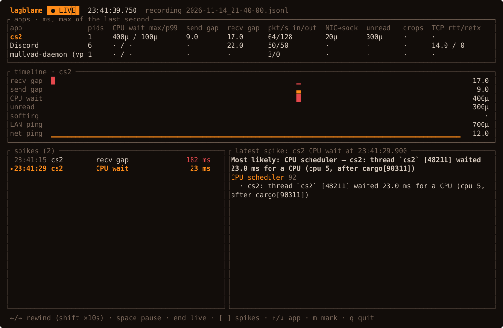

# lagblame

[](https://github.com/Tjabooo/lagblame/actions/workflows/ci.yml) [](https://github.com/Tjabooo/lagblame/releases) [](LICENSE)

**When a game or a call lags, lagblame tells you which layer it came from: the CPU scheduler, the app itself, the kernel's network stack, your VPN tunnel, your LAN/Wi-Fi, the internet, or the server.**

It watches the apps you name with eBPF, records what every layer did, and lets you rewind to "what happened at 21:43:10".



```text
$ lagblame explain --at 21:43:10
21:43:10.412  ·  cs2
Most likely: CPU scheduler — cs2: thread `cs2` [48211] waited 23.0 ms for a CPU (cpu 5, after cargo[90311])

CPU scheduler (92)
  · cs2: thread `cs2` [48211] waited 23.0 ms for a CPU (cpu 5, after cargo[90311])
```

## Features

- **Per-app, not per-machine.** Only the processes you name (and their threads) are timed.
- **Every layer between the server and your game loop:**
  - **CPU scheduler:** how long each thread waited on the runqueue after a wakeup, and what ran on that CPU instead.
  - **The app itself:** the app stopped sending, or left packets unread, while it *did* get CPU time (frame hitch, shader compile, disk, GC).
  - **Kernel network stack:** NIC → socket time per packet, NET_RX/NET_TX softirq latency, socket-buffer overflows, skb drops by reason.
  - **VPN tunnel:** in-kernel WireGuard decap time; for userspace tunnels (Mullvad, wireguard-go, Tailscale…) the tunnel process's own CPU waits and unread packets, and "packets kept reaching the tunnel but not the app".
  - **LAN / Wi-Fi vs internet:** a built-in ping probe to your gateway and to the internet (or another prober's JSON).
  - **Server:** nothing arrived while every local layer looked clean.
  - **TCP:** smoothed RTT and retransmits on the app's sockets.
- **Live TUI with rewind.** Scroll back through the timeline, jump between spikes, see the verdict for any moment.
- **Recorded sessions.** A background recorder writes one JSON Lines file per game session; `replay` and `explain` work on them later.
- **"It lagged just now" key.** `lagblame mark --notify` drops a mark and pops up the verdict a second later.
- **Cheap enough to leave on.** Hooks attach only while a watched app runs; per-event work is a map lookup or two. Measure it on your machine with `lagblame overhead`.
- **CO-RE.** One binary runs on any x86_64 kernel with BTF (`/sys/kernel/btf/vmlinux`), no kernel headers needed.

## Install

Needs Rust 1.88+, clang (to compile the BPF program), libelf and zlib.

```sh
# Arch: pacman -S --needed rust clang libelf zlib
# Debian/Ubuntu: apt install cargo clang libelf-dev zlib1g-dev pkg-config
git clone https://github.com/Tjabooo/lagblame && cd lagblame
./install.sh --service     # ~/.local/bin/lagblame + systemd user unit + example config
sudo setcap cap_bpf,cap_perfmon+ep ~/.local/bin/lagblame
```

The `setcap` line gives the binary the two capabilities it needs to load its BPF programs, so it never has to run as root. Repeat it after every reinstall (installing a new file drops the capabilities). `lagblame doctor` checks everything.

## Usage

```sh
lagblame live --app cs2 --with Discord   # live view; also records a session
lagblame record --app cs2                # headless (what the service runs)
lagblame sessions                        # what's been recorded
lagblame spikes                          # spikes in the latest session
lagblame explain --at 21:43:10           # why did it lag then?
lagblame explain                         # last mark, else the biggest spike
lagblame replay --at 21:43:10            # open the session in the viewer
lagblame mark --notify "rubberbanding"   # bind this to a key
lagblame overhead --app cs2              # what lagblame itself costs
```

Viewer keys: `←/→` move (Shift: 10 s), `PgUp/PgDn` 1 min, `[`/`]` previous/next spike, `↑/↓` pick the app, `space` pause, `End` back to live, `m` mark, `q` quit.

`--app` names a process by its name (`comm`), executable or argv[0], case-insensitive. Apps start sessions; `--with` companions (voice chat) are only watched while an app runs.

### Background recording

```sh
systemctl --user enable --now lagblame
journalctl --user -u lagblame -f     # one line per spike with its verdict
```

The unit is skipped (not failed) until the binary has its capabilities.

## Configuration

`~/.config/lagblame/config.toml`, every key optional. See [`contrib/config.example.toml`](contrib/config.example.toml).

```toml
apps = ["cs2"]
companions = ["Discord"]

[thresholds]      # ms
runqueue_ms = 4
gap_ms = 50

[probe]
mode = "builtin"  # or "file" (+ file = "path.json" with {"gw": ms, "wan": ms}) or "off"
wan_target = "1.1.1.1"

[record]
retention_days = 7
max_mb = 2048
```

## How it works

| Hook | What it measures |
| --- | --- |
| `tp_btf/sched_wakeup`, `sched_wakeup_new`, `sched_switch` | runqueue wait of each watched thread, and who had the CPU |
| `fentry/udp_sendmsg`, `udpv6_sendmsg` | send rhythm per socket (gaps on a busy flow) |
| `tp_btf/netif_receive_skb` | when a UDP packet first reached the stack (and again after an in-kernel tunnel) |
| `fentry/__udp_enqueue_schedule_skb` | arrival at the socket: receive rhythm, NIC → socket time |
| `fentry/skb_consume_udp` | when the app took the packet out of its socket |
| `tp_btf/udp_fail_queue_rcv_skb`, `kfree_skb` | socket-buffer overflows, drops by reason |
| `fentry/tcp_sendmsg`, `tcp_recvmsg`, `tcp_rcv_established`, `tp_btf/tcp_retransmit_skb` | TCP RTT and retransmits |
| `tp_btf/softirq_raise`, `softirq_entry`, `softirq_exit` | NET_RX/NET_TX softirq latency and run time |

The BPF side keeps per-CPU counters in two halves; every 250 ms user space flips a parity bit and drains the idle half, so nothing is lost and nothing is locked. Individual spikes above the thresholds go through a ring buffer with their thread, CPU and peer. User space adds the LAN/internet probe, writes a tick to the session file and runs the verdict engine, which scores each layer from what was measured in the seconds around a moment and discounts "the server" when something local explains the gap.

Hooks that a kernel lacks are skipped (`doctor` lists them) instead of failing the whole program.

### Tests

`cargo test` covers the verdict engine, session files and parsing. `tests/vm/run.sh [KERNEL]` boots a kernel in a throwaway QEMU VM (no root on the host, just `/dev/kvm`), loads the BPF programs as an unprivileged user with file capabilities, plays a 64 Hz UDP "game" in which the server goes quiet, the game hitches and a SCHED_FIFO hog steals its CPU, and checks that each one is blamed on the right layer. CI runs it against the runner's kernel.

## Limitations

- It sees what the kernel sees. GPU stalls, frame pacing and the server's own simulation are invisible, so "nothing stood out" is a real answer.
- UDP gaps can't tell a stall from a quiet flow (voice chat while nobody talks); the verdict only treats gaps on busy flows as stalls.
- Userspace tunnels are blamed through their process (CPU waits, unread packets), not per packet.
- The built-in probe is IPv4 only. Tested on x86_64 (Linux 7.2: Arch, zen).

## License

MIT. The BPF program is dual MIT/GPL, as the kernel requires a GPL-compatible license for it.
